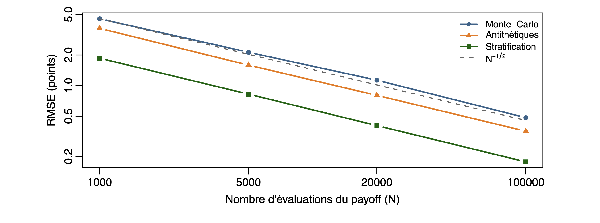
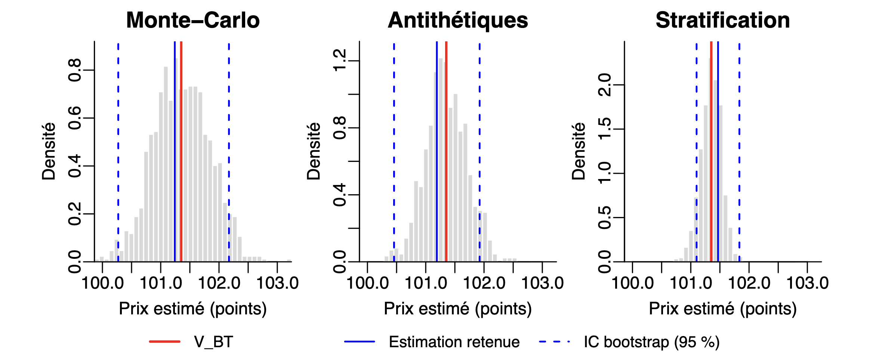

# Monte Carlo Option Pricing: Variance Reduction in R

A computational statistics project investigating how variance reduction techniques improve the accuracy of Monte Carlo pricing for European put options on the S&P 500.

## Overview

This project benchmarks three simulation methods:

- Standard Monte Carlo simulation
- Antithetic variates
- Stratified sampling

The analysis uses six SPX put options across different strikes and maturities. Estimates are validated against analytical Black–Scholes prices and evaluated using RMSE, estimator variance, and bootstrap confidence intervals.

## Key Results

For an approximately at-the-money SPX put option, using 100,000 payoff evaluations:

| Method | RMSE | Estimator variance |
|---|---:|---:|
| Standard Monte Carlo | 0.4828 | 0.2333 |
| Antithetic Variates | 0.3555 | 0.1265 |
| Stratified Sampling | **0.1776** | **0.0316** |

Stratified sampling achieved approximately **7.4× lower estimator variance** than standard Monte Carlo for this contract.

The improvements were less pronounced for deeply out-of-the-money options, highlighting the importance of payoff structure when selecting variance reduction techniques.

## Methodology

The project combines risk-neutral Monte Carlo simulation, analytical Black–Scholes benchmarks, repeated experiments across simulation budgets, and percentile bootstrap confidence intervals.

The focus is on numerical estimation uncertainty rather than uncertainty in market parameters.